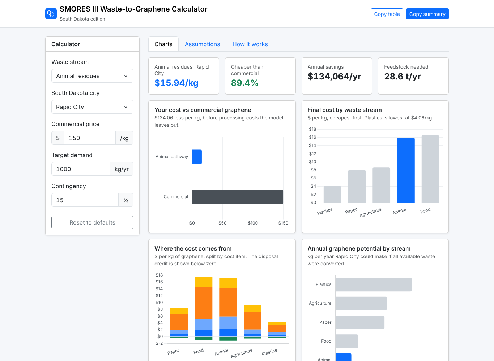
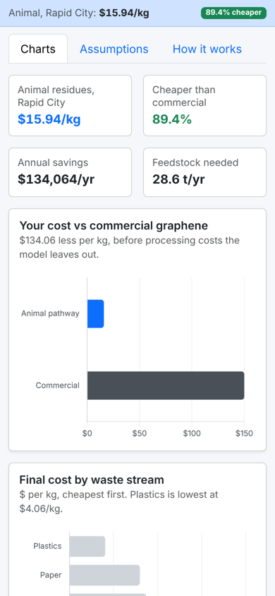

# SMORES III Waste-to-Graphene Calculator

An interactive cost calculator for **SMORES III** (*From Waste Streams to Clean Streams*), a student-led project that turns animal waste into graphene-like carbon for water filtration. It estimates how much waste-derived graphene five waste streams could produce in South Dakota cities, and what it would cost compared with commercial graphene.

This is the web version of the project's Excel calculator (`SMORES_Waste_to_Graphene_Calculator_SD_v2.1.xlsx`) and gives the same numbers. It was built at the BicBioEng Lab, University of South Dakota.

| Desktop | Phone |
|---|---|
|  |  |

## Quick start

- **Open it locally:** double-click `index.html`. It runs in any modern browser with no install and no internet connection.
- **Open it online:** see [Publish with GitHub Pages](#publish-with-github-pages).

## Features

**Calculator inputs**

| Input | Default | What it does |
|---|---|---|
| Waste stream | Animal residues | The stream the summary and charts focus on |
| South Dakota city | Rapid City | Scales the waste supply by city size |
| Commercial price | $150/kg | The price of store-bought graphene used for comparison |
| Target demand | 1,000 kg/yr | How much graphene you want to make each year |
| Contingency | 15% | A cushion for surprises when scaling up from the lab |

**Charts tab.** Four headline numbers (final cost, % cheaper than commercial, annual savings, feedstock needed), followed by six live charts:

1. Your cost vs commercial graphene
2. Final cost by waste stream
3. Where the cost comes from (collection, preprocessing, energy, labor, minus the disposal credit)
4. Annual graphene potential by stream
5. Graphene potential by city, with the target demand line
6. How conversion yield changes cost, including the break-even yield

**Assumptions tab.** Every per-stream value (supply, carbon content, conversion, and the four costs plus the credit) and every city size factor can be edited. Calculated rows and charts update instantly.

**How it works tab.** Steps, formulas, and a plain-language meaning for each number.

**Also included**

- Works on phones, with a pinned result bar, touch-sized inputs and horizontal charts on narrow screens
- Inputs are saved in the browser, and *Reset to defaults* restores the spreadsheet values
- *Copy summary* puts a ready-to-paste text summary on the clipboard, for a poster or slide
- *Copy table* puts the full table on the clipboard, ready to paste into Excel

## Model

| Quantity | Formula |
|---|---|
| Available waste (t/yr) | Rapid City base supply × city size factor |
| Net cost ($/ton) | collection + preprocessing + energy + labor/overhead − avoided disposal credit |
| Graphene output (kg/ton) | 1000 × carbon content × conversion |
| Final cost ($/kg) | net cost ÷ graphene output × (1 + contingency) |
| Annual potential (kg/yr) | available waste × graphene output |
| Feedstock needed (t/yr) | target demand ÷ graphene output |
| Annual savings ($/yr) | target demand × (commercial price − final cost) |

### Default values (from the v2.1 spreadsheet)

| Waste stream | Rapid City supply (t/yr) | Carbon (%) | Conversion (%) | Collection | Preprocess | Energy | Labor + OH | Credit |
|---|---:|---:|---:|---:|---:|---:|---:|---:|
| Paper waste | 1,800 | 45 | 12 | 35 | 60 | 220 | 80 | 20 |
| Food waste | 1,400 | 40 | 8 | 55 | 90 | 260 | 85 | 30 |
| Animal residues | 900 | 35 | 10 | 70 | 110 | 250 | 90 | 35 |
| Agriculture waste | 2,200 | 42 | 11 | 30 | 55 | 210 | 75 | 20 |
| Plastics | 1,200 | 70 | 18 | 45 | 95 | 240 | 90 | 25 |

Costs and the credit are in $/ton. City size factors relative to Rapid City: Sioux Falls 2.6, Aberdeen 0.55, Watertown 0.50, Brookings 0.45, Pierre 0.20.

With these defaults, animal residues in Rapid City come to **$15.94/kg**, 89.4% below the $150/kg benchmark. Plastics are the lowest-cost stream at $4.06/kg.

> **Planning tool, not a result.** All yields, costs, base waste amounts and city factors are illustrative placeholders, not measured SMORES values. Processing costs beyond the per-ton entries (for example pyrolysis energy at scale, exfoliation and purification) are not modelled, and the calculator has not been validated against real production. Replace the defaults with measured or literature values before making strong claims.

## Changing the defaults

All starting values live in one `DEFAULTS` object near the bottom of `index.html`:

```js
const DEFAULTS={bench:150,demand:1000,cont:15,stream:2,city:0,
  cities:[['Rapid City',1],['Sioux Falls',2.6], ...],
  streams:[
    {n:'Paper waste',s:'Paper',base:1800,c:45,d:12,e:35,f:60,g:220,h:80,i:20},
    ...
```

| Key | Meaning |
|---|---|
| `base` | Rapid City supply (t/yr) |
| `c` | Carbon content (%) |
| `d` | Conversion to graphene (%) |
| `e` | Collection ($/ton) |
| `f` | Preprocessing ($/ton) |
| `g` | Energy ($/ton) |
| `h` | Labor + overhead ($/ton) |
| `i` | Avoided disposal credit ($/ton) |

After editing, also change the `KEY` value next to `DEFAULTS` (for example `smores-calc-v6`). Otherwise browsers that already opened the page keep showing their saved values.

## Publish with GitHub Pages

1. Push this folder to `github.com/bicbioeng/smores-calculator`.
2. In the repo, go to **Settings → Pages**. Under *Build and deployment*, choose **Deploy from a branch**, then pick `main` and `/ (root)`.
3. After a minute or two the calculator is live at **https://bicbioeng.github.io/smores-calculator/**

## Project structure

```
smores-calculator/
├── index.html      # the whole app: markup, styles, model, charts
├── README.md
└── docs/
    ├── screenshot-desktop.png
    └── screenshot-mobile.png
```

`index.html` is self-contained. [Bootstrap 5.3.3](https://getbootstrap.com/) and [Chart.js 4.4.1](https://www.chartjs.org/) are embedded in it, which is why it works offline. Both libraries are MIT-licensed.

## Related work

N. Gadhamshetty and R. Yadav, "SMORES: From Waste Streams to Clean Streams with Waste-Derived Graphene Filtration Media and a Cost-Scaling Calculator," IEEE BIBM 2026.

Supported by NIH NIGMS IDeA (P20GM103443), NSF NRT (#2510643) and NSF AQUA-CLIME (#2418752).
